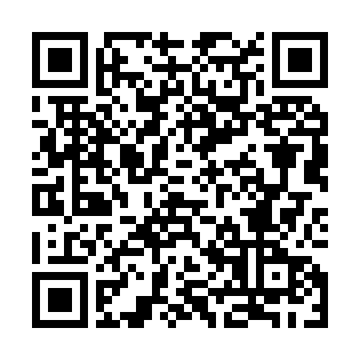

# 

A port of [Anki](https://apps.ankiweb.net) to the Nintendo 3DS.

## About

Anki is a spaced repetition program. This project brings it to the Nintendo 3DS. See the official [Anki website](https://apps.ankiweb.net) to learn more about Anki itself.

See instructions below to see how to install Anki-3DS on your device.

## Preview

## Install

You can install Anki-3DS using FBI (from SD card or by scanning QR code below) and then launch from the HOME Menu.

## Credits

Based on [Anki](https://github.com/ankitects/anki) by Damien Elmes and the Anki contributors.

## License

Anki-3DS is licensed under the same terms as Anki. See [LICENSE](./LICENSE).
